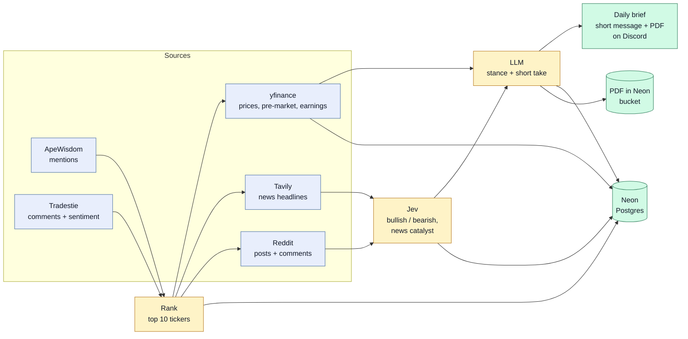
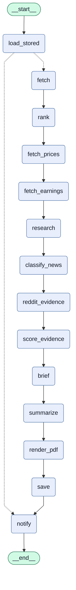

# market-sentiment-agent

A LangGraph agent that builds a daily pre-market brief for r/wallstreetbets stocks: which tickers are suddenly being talked about, whether the talk is bullish or bearish, what the news and the price say about it, and an opinionated take on what is worth trading today.

## Goals
- **Find what is hot.** Rank tickers by how fast WSB attention is rising (ApeWisdom mentions, Tradestie comments), not by raw volume alone.
- **Read the direction.** Score the WSB posts and comments about each hot ticker as bullish, bearish or neutral with the Jev decision model.
- **Check it against reality.** Compare the buzz with the price (prior day and pre-market), upcoming earnings and today's headlines, and say when they disagree.
- **Give a usable brief.** An LLM turns the facts into a stance and a short take per ticker, plus the few tickers most worth a look, and the report is posted to Discord before the US open.
- **Build a track record.** Everything is saved to Postgres every day, so later we can test whether the signal predicts anything. See [ROADMAP.md](ROADMAP.md).

This is a portfolio project, not a trading system. The Reddit signal is weak on its own and the history is short.

## The big picture

Two attention lists pick the top 10 tickers. For those, the pipeline gathers prices, news and Reddit chatter, Jev labels the sentiment and the news catalysts, an LLM turns the facts into a stance per ticker, and the brief lands on Discord. Everything is saved to Postgres along the way.

## How it works
The pipeline is a fixed LangGraph graph, one file per node in `agent/nodes/`. Facts and numbers come straight from data and fill a fixed template. Jev answers narrow classification questions, and one LLM call writes the opinions from those facts, so it cannot invent numbers.



1. **load_stored**: if today's report is already in Neon, reuse it (no new API calls) and go straight to `notify`.
2. **fetch**: top 50 tickers from ApeWisdom (mentions and 24h change) and from Tradestie (comment counts and sentiment).
3. **rank**: merge both lists into a top-10. A ticker picked by more sources ranks higher. Index funds and word-tickers like AI or YOU are skipped.
4. **fetch_prices**: yfinance daily prices for all tickers, plus pre-market or after-hours price against the last regular close for the top 10, and SPY and QQQ for context.
5. **fetch_earnings**: next earnings date per candidate (yfinance).
6. **research**: today's headlines per candidate (Tavily).
7. **classify_news**: Jev labels each headline's catalyst (earnings, analyst, deal, legal, macro, price-action).
8. **reddit_evidence**: WSB posts and comments about each candidate. Arctic Shift (a free Reddit archive) first, Tavily limited to reddit.com as a backup. Tickers that are also everyday words (AI, ON, IT, NOW) only count when written as `$TICKER`, near a finance word ("NOW calls") or alongside the company name, so general chatter is not mistaken for the stock.
9. **score_evidence**: Jev labels each post and comment, then rolls the labels up per ticker.
10. **brief**: one LLM call writes an overview, up to 3 top picks and a stance, horizon and short take per ticker (`agent/prompts.py` holds the system prompt).
11. **summarize**: fills the report template.
12. **render_pdf**: renders the report as a designed PDF (header, market strip, top picks, one card per ticker with a stance badge and a sentiment bar).
13. **save**: writes the day's data and the LLM's per-ticker picks (`brief_picks`, flagged `degraded` if a stage failed) to Neon, and archives the PDF in the Neon bucket (`briefs/<date>.pdf`). The report text and PDF are stored only if no stage failed, so a rerun never reuses a report with gaps.
14. **notify**: posts a short message (overview and top picks) with the PDF attached to Discord, once per day. On a rerun it posts the archived PDF from the bucket.

A stage that fails is recorded and the rest keep going; the report still prints. At the end the run exits non-zero, so a scheduled job turns red and posts an alert to Discord.

| Exit code | Stage |
|---|---|
| 2 | Reddit evidence |
| 3 | ApeWisdom |
| 4 | Jev |
| 5 | Database |
| 6 | Tradestie |
| 7 | Daily prices |
| 8 | Pre-market prices |
| 9 | Earnings dates |
| 10 | Tavily news |
| 11 | LLM brief |
| 12 | Discord |
| 13 | PDF rendering |

## Run it
Copy `.env.template.md` to `.env` and fill in your keys, then:

```
uv run main.py                  # reuses today's stored report if there is one
uv run main.py --refresh        # rebuild it
uv run main.py --collect-only   # save data only: no Jev, no LLM, no report, no Discord
uv run main.py --resend         # post to Discord even if today's report was already sent
```

A rerun without `--refresh` makes no API calls: it reuses the stored report and, if it has not been sent today, posts the archived PDF from the bucket. Add `--resend` to post it again.

Keys: `JEV_API_KEY`, `TAVILY_API_KEY`, `OPENAI_API_KEY`, `DATABASE_URL`, `DISCORD_WEBHOOK_URL`, the four bucket variables (`AWS_ACCESS_KEY_ID`, `AWS_SECRET_ACCESS_KEY`, `AWS_ENDPOINT_URL_S3`, `AWS_REGION`, from `neon env pull`), and `BRIEF_MODEL` / `BRIEF_EFFORT` to choose the LLM (leave `BRIEF_MODEL` unset to skip the LLM and get a template-only report).

## Scheduled run
`.github/workflows/daily.yml` runs `main.py` every day at 13:47 UTC (8:47am ET in winter; change to 12:47 UTC when US summer time starts in March, or it lands after the open). The schedule is off the hour because GitHub delays or drops runs at :00. It needs these repo secrets: `DATABASE_URL`, `JEV_API_KEY`, `TAVILY_API_KEY`, `OPENAI_API_KEY`, `DISCORD_WEBHOOK_URL` and the four bucket variables above (without them the PDF is still sent, just not archived). If the job fails, a final step posts the failing stages to Discord. Add secrets under Settings > Secrets and variables > Actions, or with `gh secret set NAME`. You can also start a run by hand from the Actions tab.

## What it stores
Postgres tables in Neon, created on first use (`db/`). A rerun on the same day replaces that day's rows.
- `trending_snapshots`: the day's top 50 ApeWisdom tickers, and which were picked as candidates.
- `tradestie_snapshots`: Tradestie's top 50 with sentiment and comment counts.
- `daily_prices`: daily close and volume.
- `ticker_news`: headlines per candidate, with Jev's catalyst label.
- `reddit_evidence`: every Reddit post and comment used, with its text, votes, URL, source, Jev label and confidence.
- `brief_picks`: one row per ticker per day: the LLM's stance, horizon and take, whether it was a top pick (rank, direction, reason), the price at report time, the facts the LLM was given (jsonb), the model and a prompt hash, and a `degraded` flag. Saved even when a stage failed, so every day's picks can be queried.
- `newsletters`: the finished report per day, with `sent_at` so it is only sent once, and `pdf_key` pointing to the PDF in the bucket.
- `post_scores`: the old generic top-10 posts (no longer written).

The Neon object-storage bucket (`assets`, private) holds each day's PDF at `briefs/<date>.pdf`.

## Layout
```
main.py            entry point
sources/           one file per outside data source: apewisdom, tradestie, prices, earnings, news, reddit_search, discord
agent/             the LangGraph pipeline
  state.py         the shared State and the exit codes
  graph.py         wires the nodes together
  facts.py         turns the state into one facts record per ticker
  prompts.py       the LLM system prompt
  report.py        report text to the short Discord message and the PDF
  jev.py           the Jev classifier (sentiment and catalyst questions)
  nodes/           one file per node
  diagram.py       prints the Mermaid diagram above and saves it to docs/pipeline.mmd
db/                Neon storage, one file per table group
docs/              pipeline.mmd, the generated graph diagram
tests/             unit tests (uv run --with pytest pytest tests)
evals/             baseline eval of Jev
neon_database/     Neon project config
```
After changing the graph, regenerate the diagram with `uv run python -m agent.diagram`. It prints the Mermaid source, saves it to `docs/pipeline.mmd` (the always-current copy) and you paste it into the block above.

## Known limits
- **Reddit coverage is patchy.** Arctic Shift often times out, so several tickers fall back to Tavily (snippets only, no votes). The report marks those as thin.
- **Scheduled runs can start late.** GitHub cron on this repo has run hours behind schedule, so the brief may land after the US open.
- **Pre-market prices are thin.** Extended-hours moves come from low volume, so treat them as hints.
- **Short history.** The signal is untested; the track record is still being collected. The brief is opinionated but automated, so verify before trading.

## Cost per run
About 100 Jev calls, 10-20 Tavily credits and one LLM call (about 4,200 tokens in and 2,600 out on `gpt-6-luna`, well under a cent). The PDF is about 13 KB.

## Evals
`evals/` holds a baseline check of Jev on 60 labeled finance tweets and headlines (about 83% accurate; labels under 0.5 confidence are right less than half the time). See [evals/README.md](evals/README.md). The plan for evaluating ticker matching and the picks themselves is in [ROADMAP.md](ROADMAP.md).

## Neon (database and storage)
The Neon config lives in `neon_database/` (`neon.ts` declares the services). Run Neon CLI commands from inside that folder. To refresh the Neon variables in the root `.env`:

```
cd neon_database
neon env pull --file ../.env
```

Only run `neon deploy` after changing `neon.ts`.
